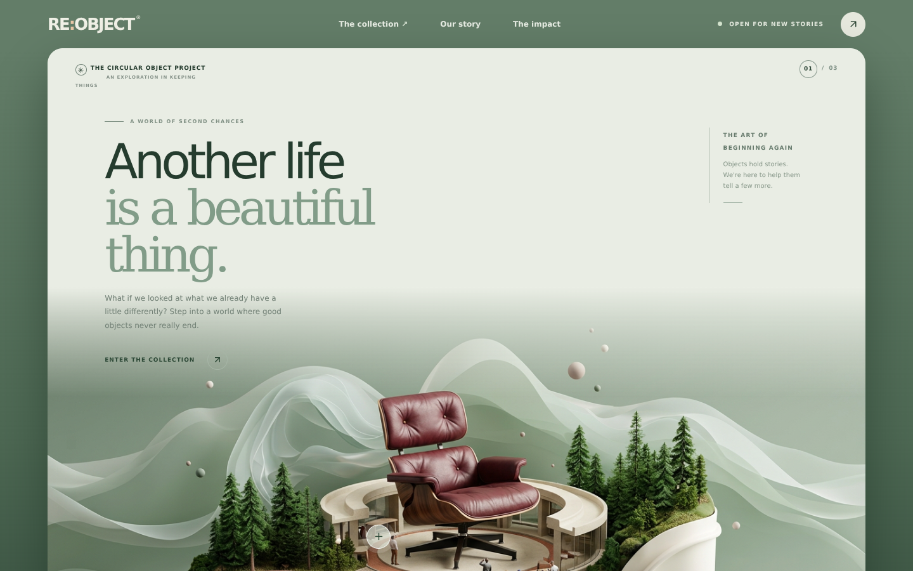
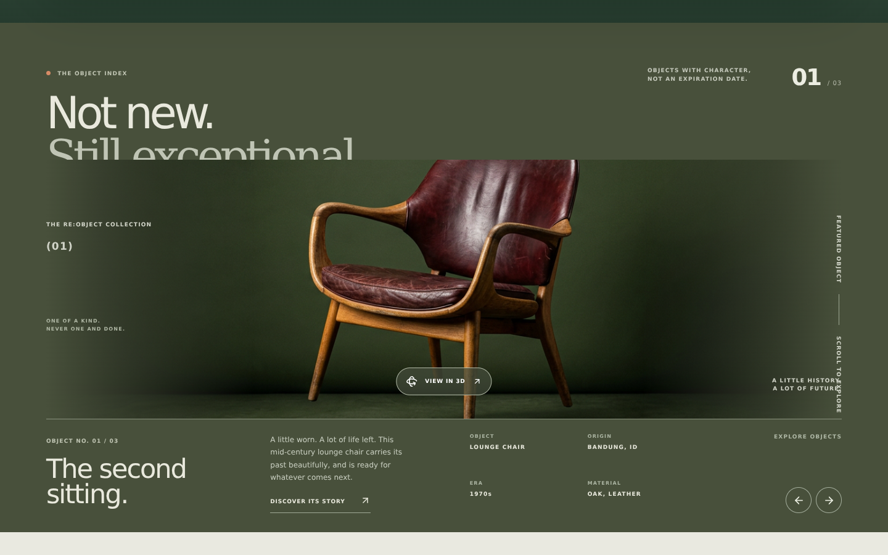
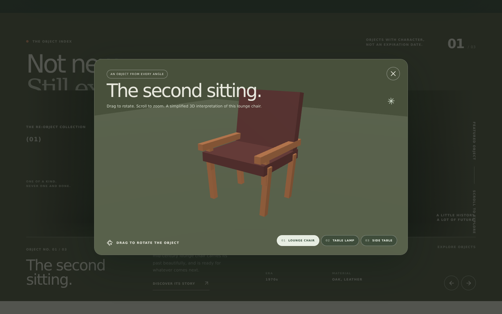
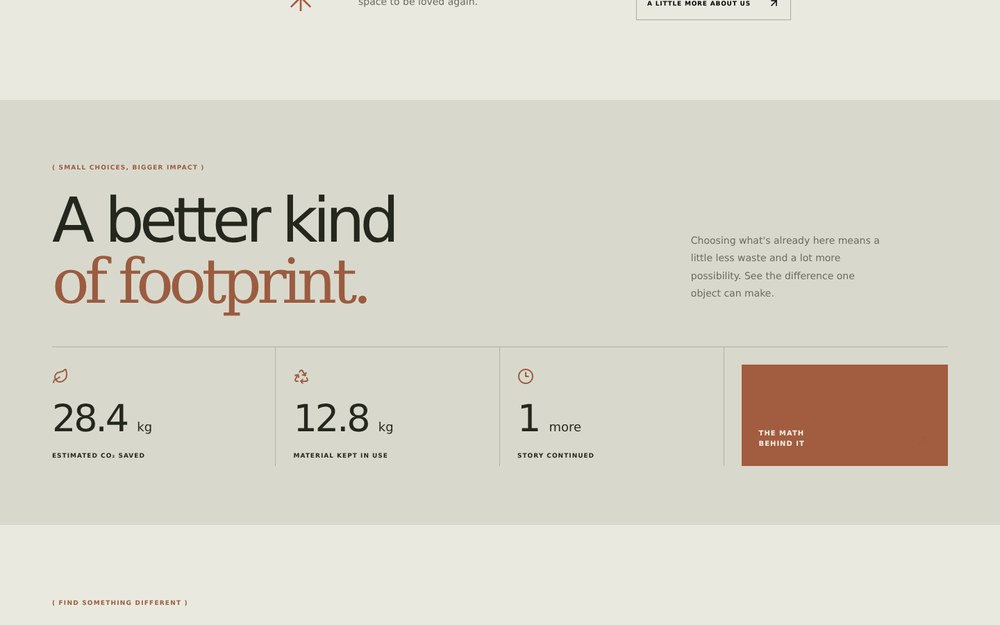
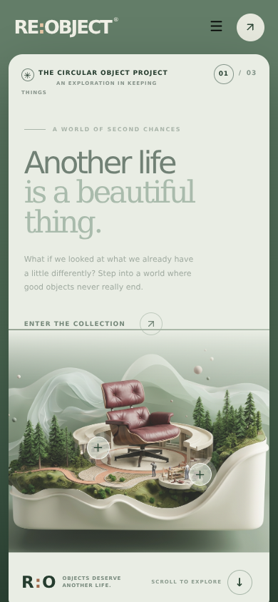

<div align="center">

# RE:OBJECT

### Objects deserve another life.

**Eksplorasi benda preloved, cerita di baliknya, dan kemungkinan hidup berikutnya.**

Sebuah konsep frontend interaktif yang menggabungkan galeri produk editorial, dunia miniatur, dan visualisasi 3D untuk merayakan benda yang sudah ada.

[Menjelajahi fitur](#fitur) · [Galeri aplikasi](#galeri-aplikasi) · [Menjalankan proyek](#menjalankan-proyek) · [Deployment](#deployment)

</div>

---

## Tentang proyek

RE:OBJECT membayangkan pengalaman menjelajahi barang bekas sebagai galeri produk premium. Setiap objek memiliki karakter, cerita, dan kesempatan untuk digunakan kembali. Desainnya memadukan warna earthy, tipografi editorial, lanskap organik, serta interaksi berbasis Three.js.

> **Status:** frontend concept / demo. Produk, riwayat, dan angka dampak merupakan data ilustratif; aplikasi ini belum terhubung ke backend, transaksi, atau inventaris nyata.

## Galeri aplikasi

### Dunia RE:OBJECT

Halaman pembuka menampilkan dunia miniatur dengan hotspot interaktif untuk mengeksplorasi objek dan ceritanya.



### Koleksi objek

Telusuri objek, detail material dan asal, serta cerita di balik setiap barang.



### Viewer 3D

Putar dan perbesar model kursi, lampu, atau meja; berpindah objek langsung dari viewer.



### Dampak penggunaan ulang

Angka ilustratif membantu membayangkan potensi dampak memperpanjang masa pakai objek.



### Tampilan mobile



## Fitur

- **Dunia interaktif:** ilustrasi hero dengan hotspot untuk cerita objek dan viewer 3D.
- **Koleksi terkurasi:** navigasi antarobjek dan filter kategori furnitur atau pencahayaan.
- **Eksplorasi 3D:** rotasi otomatis, drag untuk memutar, dan scroll untuk zoom. Model merupakan interpretasi geometris sederhana, bukan pemindaian produk asli.
- **Cerita objek:** tahapan ditemukan, diperbaiki, dan siap digunakan kembali.
- **Dampak ilustratif:** estimasi CO₂ dan material yang tetap digunakan. Angka bukan hasil perhitungan siklus hidup atau klaim terverifikasi.
- **Responsif:** tata letak untuk desktop dan perangkat mobile, termasuk dukungan reduced motion.

## Teknologi

| Teknologi | Peran |
| --- | --- |
| React | Antarmuka dan state interaktif |
| Vite | Development server dan production build |
| Three.js | Visualisasi objek 3D dan OrbitControls |
| Lucide React | Ikon antarmuka |
| CSS | Tata letak responsif, tipografi, dan animasi |

## Menjalankan proyek

**Prasyarat:** Node.js 20.19+ atau 22.12+ dan npm.

```bash
git clone https://github.com/rilians/re-object.git
cd re-object
npm install
npm run dev
```

Buka alamat yang ditampilkan Vite, biasanya `http://localhost:5173`.

### Perintah tersedia

```bash
npm run dev      # Jalankan development server
npm run build    # Buat production build di dist/
npm run preview  # Tinjau hasil production build secara lokal
```

## Struktur proyek

```text
re-object/
├── docs/screenshots/  # Tangkapan layar aplikasi untuk README
├── public/            # Aset visual lokal
├── src/
│   ├── main.jsx       # Aplikasi React dan viewer Three.js
│   └── style.css      # Gaya dan layout responsif
├── index.html
├── package.json
└── vite.config.js
```

## Deployment

Proyek ini adalah situs statis Vite. Untuk deploy di Vercel, impor repository dan gunakan preset **Vite**, perintah build `npm run build`, serta output directory `dist`. Tidak ada environment variable yang diperlukan untuk demo ini.

## Catatan

- Favorit hanya disimpan dalam state sementara dan akan hilang saat halaman dimuat ulang.
- Beberapa gambar produk dan font dimuat dari layanan eksternal, sehingga membutuhkan koneksi internet.
- Angka dampak, cerita, dan informasi produk adalah contoh untuk keperluan demonstrasi.

---

<div align="center"><strong>Less new. More meaning.</strong><br />Made with intention in Indonesia.</div>
